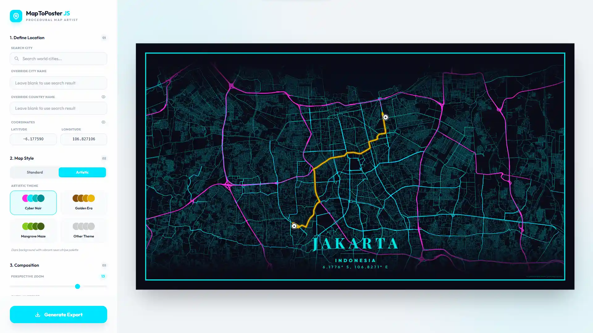

<p align="center">
  
</p>

# MapToPoster JS

[English](README.md) | 简体中文 | [日本語](README.ja.md)

[](https://developer.mozilla.org/en-US/docs/Web/HTML) [](https://developer.mozilla.org/en-US/docs/Web/CSS) [](https://developer.mozilla.org/en-US/docs/Web/JavaScript) [](https://tailwindcss.com/) [](https://leafletjs.com/) [](https://maplibre.org/) [](https://vitejs.dev/)


MapToPoster JS 是一款专业级的纯客户端 Web 应用，可帮助你轻松生成自定义地图海报。无论你想创作极简城市艺术作品，还是色彩鲜明的地理纪念品，这款工具都能让你搜索世界上的任意地点，并借助完全可自定义的主题、布局和高保真导出选项，将其转化为精美的地图海报。作为一款功能丰富的地图海报生成器，本应用专注于适合大幅面打印的高分辨率输出，是制作独特墙面装饰或个性化礼物的理想工具。



## 🚀 主要功能

- **混合渲染系统**：可在高效的瓦片地图（Leaflet）与程序化矢量艺术（MapLibre GL）之间无缝切换。
- **精确地理编码**：由 Nominatim API 提供支持，可即时搜索全球地点。
- **动态标记**：放置、拖动多个地点标记，并通过多种图标和可调尺寸设置其样式。
- **自定义旅行路径**：通过集成的路线绘制和动态路径获取功能，将旅程或特定行程直观呈现出来。
- **卡纸 / Passepartout 边框**：应用经典的画廊式装裱效果，并可自定义宽度、边框粗细和不透明度。
- **优雅排版**：精选优质字体，完整支持自定义文本和坐标覆盖。
- **可拖动界面叠层**：流畅的城市标签叠层，具备自动边缘限制和对称安全间距。
- **背景边缘效果**：使用柔和的暗角阴影或边缘轻微透明效果提升可读性。
- **灵活布局**：可分别开关国家名称、地理坐标和地图标签，打造个性化外观。
- **专业级导出**：按自定义分辨率或超高分辨率（最高 50,000px）生成高保真 PNG 文件。
- **隐私与性能**：通过 LocalStorage 持久保存设置，并采用 100% 客户端渲染；你的数据绝不会离开浏览器。

## 🎨 主题

MapToPoster JS 提供两种不同的地图样式设计方式：

### 标准主题（Leaflet）
基于成熟服务商提供的高质量栅格瓦片：
- **Minimal White**：简洁现代（CartoDB Positron）。
- **Midnight Dark**：精致的深色模式（CartoDB Dark Matter）。
- **Classic Street**：标准 OpenStreetMap 地图样式。
- **Modern Voyager**：色彩丰富、细节清晰（CartoDB Voyager）。
- **Satellite View**：高分辨率影像（Esri World Imagery）。

### 艺术主题（MapLibre GL）
采用程序化配色的手工矢量样式：
- **Arctic Frost**：淡蓝色与明亮白色。
- **Aurora Glow**：变幻的绿色与粉色。
- **Cyber Glitch**：具有数字质感的霓虹点缀。
- **Paper Heritage**：复古棕褐色调与墨线道路。
- **Volcanic Ash**：深炭灰色搭配熔岩般的发光点缀。
- **Blueprint Classic**：适合建筑风格的技术蓝图样式。
- ……以及 Retro Synth、Charcoal Sketch 和 Sakura Bloom 等更多独特主题。

### 自定义主题
编辑 [src/core/artistic-themes.js](src/core/artistic-themes.js)，即可轻松添加自己的艺术主题：

1. 打开 `artistic-themes.js`。
2. 在 `artisticThemes` 导出中添加一个新对象：
```javascript
your_theme_key: {
    name: "Your Theme Name",
    description: "Brief description of the style",
    bg: "#HEXCODE",
    text: "#HEXCODE",
    water: "#HEXCODE",
    parks: "#HEXCODE",
    road_motorway: "#HEXCODE",
    road_primary: "#HEXCODE",
    road_secondary: "#HEXCODE",
    road_default: "#HEXCODE"
}
```
应用会自动识别新主题，并将其显示在选择菜单中。

## 🛠️ 技术栈

- **框架**：原生 JavaScript（ES Modules）
- **打包工具**：[Vite 5](https://vitejs.dev/)
- **地图**：[Leaflet](https://leafletjs.com/)（栅格）和 [MapLibre GL](https://maplibre.org/)（矢量）
- **样式**：[Tailwind CSS 3](https://tailwindcss.com/)
- **渲染**：[html2canvas](https://html2canvas.hertzen.com/)
- **排版**：Google Fonts，包括 Outfit、Playfair Display 和 Cormorant Garamond
- **API**：Nominatim（搜索）和 OSRM（路线）

## 📦 快速开始

按照以下步骤在本地获取并运行项目副本。

### 前置条件

* **Node.js**：18.0.0 或更高版本
* **npm**：通常随 Node.js 一同提供

### 安装与设置

1. **克隆仓库**
   ```bash
   git clone https://github.com/dimartarmizi/map-to-poster.git
   cd map-to-poster
   ```

2. **安装依赖**
   ```bash
   npm install
   ```

3. **启动开发服务器**
   ```bash
   npm run dev
   ```
   应用将运行在 `http://localhost:5173`。

4. **构建生产版本**
   ```bash
   npm run build
   ```
   优化后的文件将生成在 `dist/` 文件夹中。

## 🐳 使用 Docker 部署

本项目已配置为使用多阶段构建，以轻量级 Docker 容器运行：

- **构建阶段**：使用 Node.js 安装依赖并生成 Vite 生产构建。
- **运行阶段**：使用 Nginx Alpine 提供 `dist/` 中的静态文件。

### 构建镜像

```bash
docker build -t map-to-poster .
```

### 运行容器

```bash
docker run -d -p 8080:80 --name map-to-poster map-to-poster
```

然后打开 `http://localhost:8080`。

### 更新部署

拉取新更改后，重新构建并创建容器：

```bash
docker build -t map-to-poster .
docker rm -f map-to-poster
docker run -d -p 8080:80 --name map-to-poster map-to-poster
```

### 包含的 Docker 文件

- `Dockerfile` — 多阶段生产镜像
- `.dockerignore` — 缩小构建上下文
- `docker/nginx.conf` — 带有 `index.html` 单页应用回退的 Nginx 配置

## 📜 技术概览

1. **响应式状态管理**：使用基于观察者模式的存储（[src/core/state.js](src/core/state.js)），在界面、Leaflet 和 MapLibre 引擎之间同步更改。所有用户偏好均通过 `localStorage` 持久保存。
2. **混合地图引擎**：在 Leaflet（栅格瓦片）与 MapLibre GL（矢量主题）之间实现双向视口同步，无论当前使用哪种渲染模式，都能保持布局一致。
3. **可拖动叠层系统**：利用实时边界框计算限制标签位置，确保标签与海报边缘之间始终留有对称的最小 8px 安全间距。
4. **动态资源集成**：管理自定义 GeoJSON 路线和多个标记实例，并支持在两种地图引擎中进行交互式拖放。
5. **卡纸装裱层**：实现虚拟的“Mat/Passepartout”界面，可自定义内缩间距和内边框，呈现画廊式效果。
6. **高保真渲染管线**：导出时使用 [src/core/export.js](src/core/export.js) 中的多阶段流程，通过 `html2canvas` 和 `onclone` 回调生成高分辨率地图快照。

## 🤝 致谢

- **灵感来源**：灵感来自 [originalankur/maptoposter](https://github.com/originalankur/maptoposter)。本项目使用不同的技术栈和架构独立实现。
- **贡献者**：衷心感谢所有通过代码、错误报告和建议帮助改进本项目的贡献者。你们的支持让这款工具不断进步。

## 📧 联系方式

如果你有任何问题、建议或只是想取得联系，欢迎发送邮件至 [dimartarmizi@gmail.com](mailto:dimartarmizi@gmail.com)。

## ⚖️ 许可证

本项目为开源项目，采用 [MIT License](LICENSE)。
